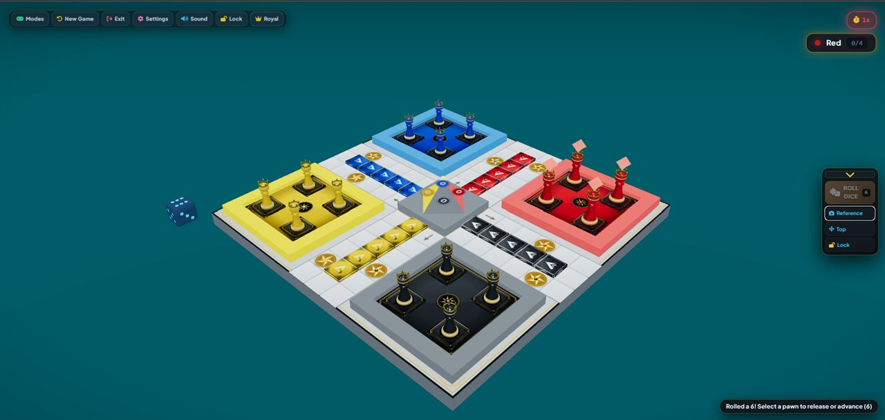
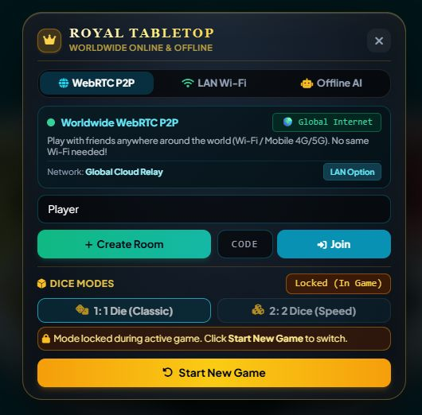
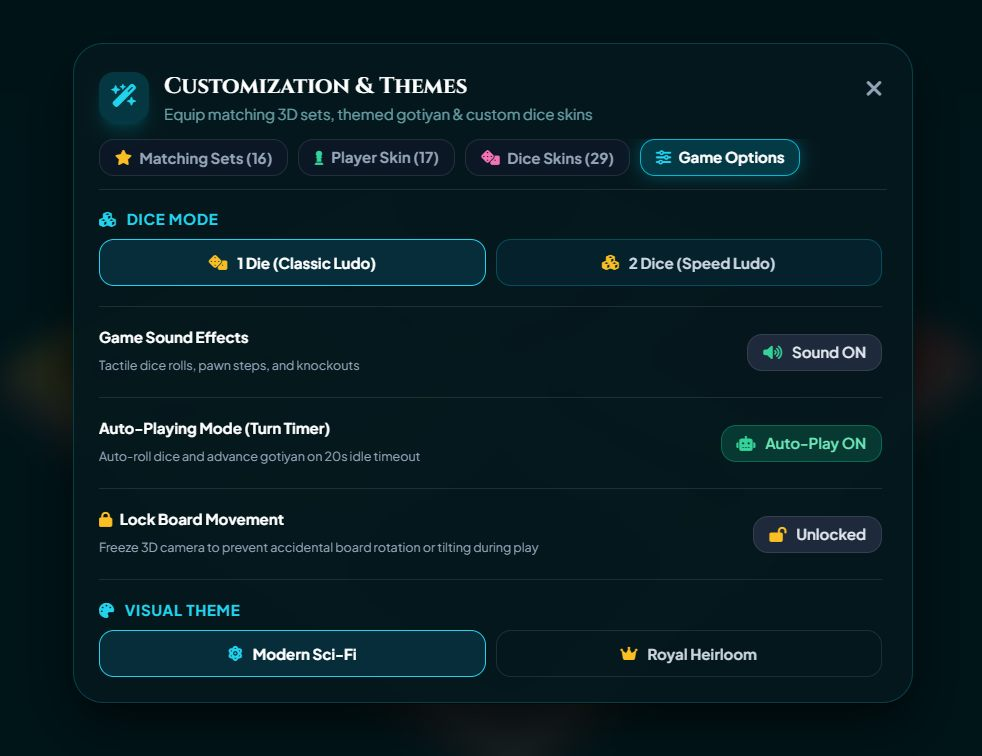
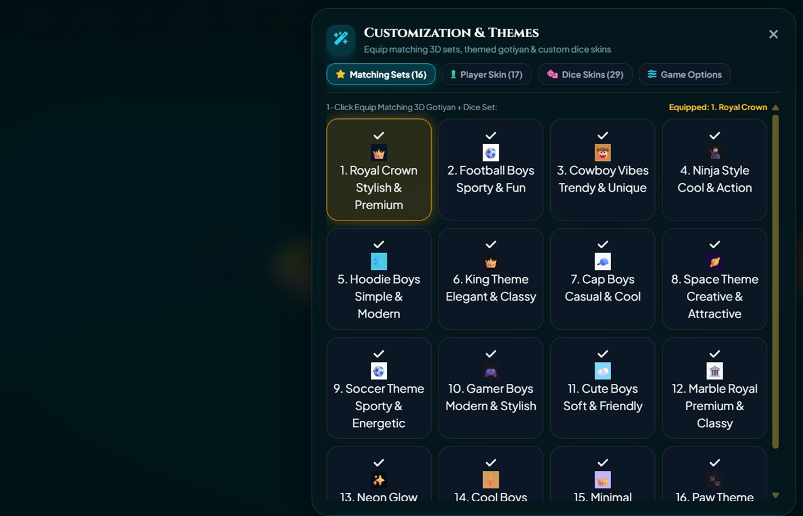
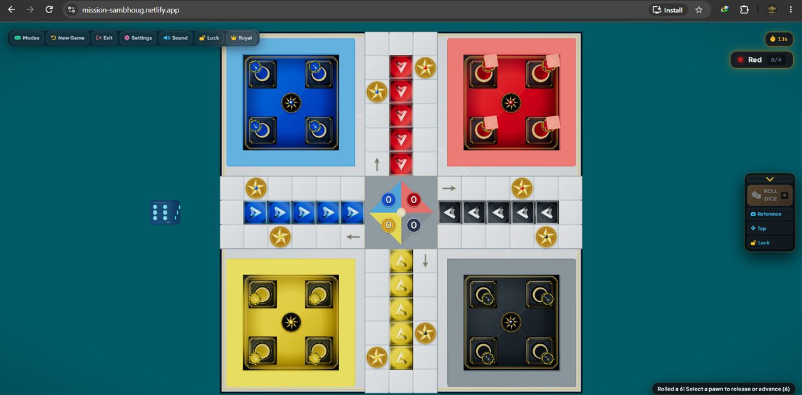

# Mission Sambhoug — 3D Ludo

**A cross-platform 3D WebGL Ludo experience with real-time online multiplayer, smart AI bots, and dual dice modes.**

[-GitHub%20Releases-24292F?style=for-the-badge&logo=github&logoColor=white)](https://github.com/rajpoot-8047/Ludo-3D/releases/latest)

---

## Visual Gallery

| Main 3D Board & HUD | Match Setup & Lobby |
| :---: | :---: |
|  |  |
| **Gameplay & Dice Action** | **3D Perspective & Token Moves** |
|  |  |
| **Multiplayer & Modes** | |
|  | |

---

## Key Features

- **Interactive Three.js 3D WebGL Board** — Smooth 3D camera controls, animated token movement, and responsive board rendering across desktop and mobile screens.
- **Online Multiplayer (Socket.io + WebRTC)** — Real-time room-based multiplayer with low-latency state synchronization and peer-to-peer connectivity.
- **Smart AI Bots** — Tactical computer opponents for solo matches or filling open seats in multiplayer lobbies.
- **One-Dice & Two-Dice Modes** — Switch between classic single-dice Ludo rules and fast-paced two-dice gameplay.
- **Cross-Platform Availability** — Play anywhere on **Web** (`https://mission-sambhoug.netlify.app/`), **Windows (`.exe`)**, **Android (`.apk`)**, **Linux (`.deb`)**, and **macOS / iOS (Web / Capacitor)**.

---

## Platform Downloads

| Platform | Format / Access | Link |
| :--- | :--- | :--- |
| **Web App** | Instant Browser Play | [Play Live at mission-sambhoug.netlify.app](https://mission-sambhoug.netlify.app/) |
| **Windows (x64)** | Installer / Executable (`.exe`) | [Download from GitHub Releases](https://github.com/rajpoot-8047/Ludo-3D/releases/latest) |
| **Android** | Package (`.apk`) | [Download from GitHub Releases](https://github.com/rajpoot-8047/Ludo-3D/releases/latest) |
| **Linux** | Debian Package (`.deb`) | [Download from GitHub Releases](https://github.com/rajpoot-8047/Ludo-3D/releases/latest) |
| **macOS / iOS** | Web / Capacitor | [Play Live at mission-sambhoug.netlify.app](https://mission-sambhoug.netlify.app/) |

---

## Private-Source Security Notice

> **Note:** This repository is a **source-code-free public showcase**. The application source code, server logic, and build configurations are kept private. Official compiled binaries are published exclusively through [GitHub Releases](https://github.com/rajpoot-8047/Ludo-3D/releases/latest), and the hosted web build is served at [https://mission-sambhoug.netlify.app/](https://mission-sambhoug.netlify.app/).
